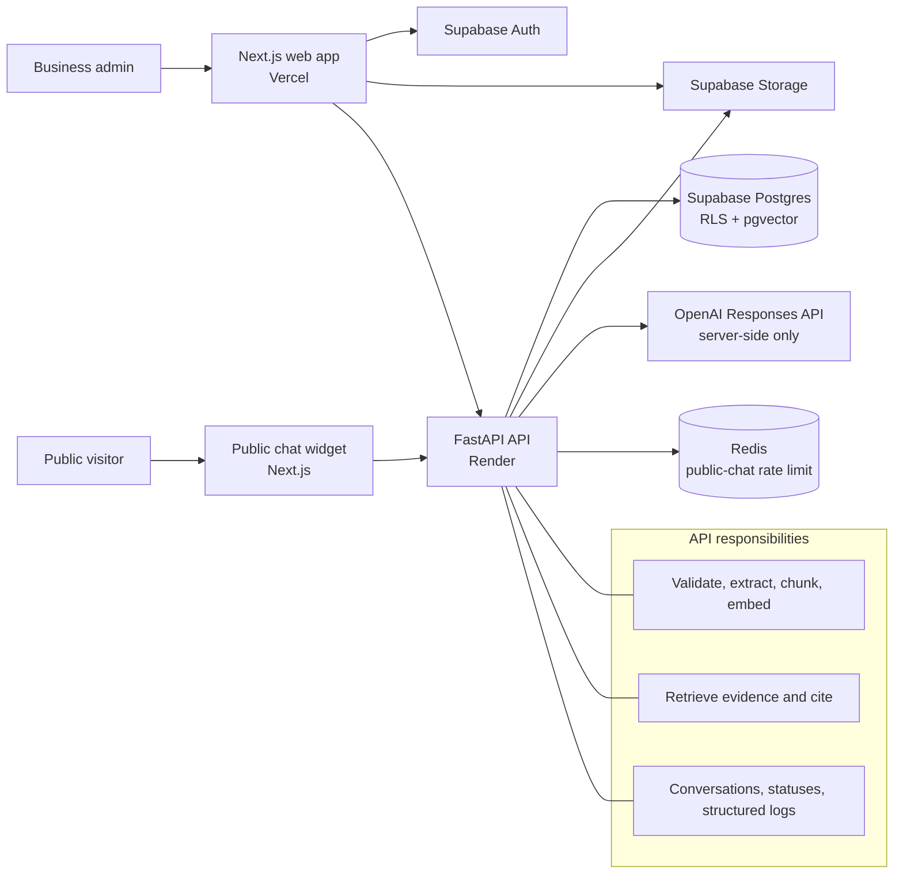

# SupportDock Architecture (Planned)

This diagram describes the intended production architecture. It is a design artifact for future milestones, not evidence that the services below are implemented.

## Trust boundaries

- The browser receives only Supabase public configuration and user-scoped access tokens.
- The FastAPI service holds server-only secrets and makes OpenAI requests.
- Supabase RLS protects tenant records even when client access reaches Supabase directly.
- The public widget identifies a published workspace but must never receive privileged credentials.
- Citations are derived from retrieved chunk metadata; generated answers without adequate retrieved evidence are rejected in favor of human handoff.
